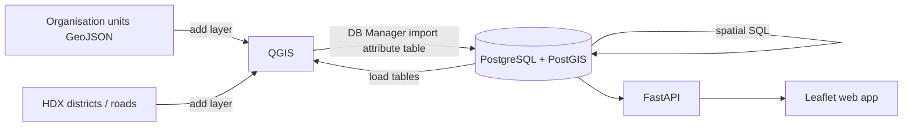

# FacilityGeo

Database-driven map app for a Malawi health-information-system rollout: where facilities stand, where gaps are, and which not-started sites cluster together.

**Method:** same as the course spatial-database lecture (QGIS → PostGIS → spatial SQL → map), using **DHIS2 Organisation units** instead of schools.

**Stack:** PostgreSQL 17 + PostGIS 3.7 + `pg_trgm` · FastAPI · Leaflet + Tailwind (CDN) · QGIS

**Data:** real DHIS2 organisation-unit points (908), HDX districts (28), real rollout tracker (59 rows, 47 matched). No seed data. Real files stay out of Git (`data/`).

## Spatial methods

| Question | Method (lecture-style PostGIS) |
|---|---|
| Import points with attributes | QGIS **DB Manager → Import layer** → table + `geom` |
| Check CRS | `ST_SRID` + `spatial_ref_sys` |
| District label from parent | `ALTER` / `UPDATE` on `parentName` |
| Facilities too close to main roads | Multi-value buffer + `ST_Contains` + `ST_Transform` |
| Point in district | `ST_Contains` (org unit ∩ HDX polygon) |
| Clusters of not-started facilities | `ST_ClusterDBSCAN` + `ST_ConvexHull` |
| % live per district | `GROUP BY` DHIS2 district name (joined to HDX by name) |
| Facilities within N km | `ST_DWithin` on `geography` |

## Architecture



Same path as the lecture; the web app is the extra step that reads the same database.

Step-by-step: [`qgis/IMPORT.md`](qgis/IMPORT.md) · SQL: [`database/lecture_style_orgunits.sql`](database/lecture_style_orgunits.sql)

## Run locally

**1. PostGIS database** (pgAdmin or CLI)

```bash
createdb facilitygeo
psql -d facilitygeo -c "CREATE ROLE geo LOGIN"
psql -d facilitygeo -c "\password geo"
psql -d facilitygeo -f database/setup.sql
cp .env.example .env
```

**2. QGIS import** (Organisation units → PostGIS)

1. Connect QGIS to `facilitygeo`.
2. Add Organisation units GeoJSON → **DB Manager → Import** → `organisation_units`.
3. Run lecture-style SQL, then tracker match:

```bash
psql -d facilitygeo -f database/lecture_style_orgunits.sql
psql -d facilitygeo -f database/match_tracker.sql
psql -d facilitygeo -f database/apply_tracker.sql
```

**3. Web app**

```bash
python3 -m venv .venv && source .venv/bin/activate
pip install -r requirements-dev.txt
uvicorn app.main:app --reload   # http://127.0.0.1:8000
```

## Notes

- **% live** = live ÷ matched tracked facilities. District tooltips show tracked counts.
- **12 tracker rows** unmatched are listed in the app summary.
- API is for localhost only (no auth).

## Layout

```
app/        FastAPI
database/   setup, lecture_style_orgunits, match, apply
frontend/   map UI
qgis/       IMPORT.md, project, styles
tests/      API tests
```
