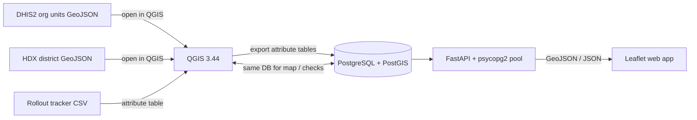

# FacilityGeo

Database-driven map app for a Malawi health-information-system rollout: where facilities stand, where gaps are, and which not-started sites cluster together.

**Stack:** PostgreSQL 17 + PostGIS 3.7 + `pg_trgm` · FastAPI · Leaflet + Tailwind (CDN) · QGIS

**Data:** real DHIS2 facility points (908), HDX districts (28), and a real rollout tracker (59 rows, 47 matched). No seed or simulated data. No officers, funder, internet, or power columns in the tracker used. Real files stay out of Git (`data/`).

## Spatial methods

| Question | Method |
|---|---|
| Facilities within N km | `ST_DWithin` on `geography` |
| Clusters of not-started facilities | `ST_ClusterDBSCAN` (EPSG:32736) + `ST_ConvexHull` |
| % live per district | `GROUP BY` DHIS2 district name (joined to HDX by name). QGIS cross-checks counts with `ST_Contains` |
| Tracker → facility match | DHIS2 code → exact name → core name → `pg_trgm` fuzzy → manual matches |

## Architecture



1. **QGIS** opens the GeoJSON / CSV and shows the **attribute table**.
2. **Export** those fields into PostGIS tables (`orgunits_raw`, `districts_hdx`, `tracker_raw`).
3. SQL builds `facilities` and matches the tracker.
4. **FastAPI + Leaflet** read PostGIS and draw the map.

- **Database:** local PostgreSQL 17 with PostGIS 3.7 and `pg_trgm`. No Docker.
- **API:** FastAPI, parameterised queries only, inputs validated with pydantic. `/docs` has the interactive reference.
- **Frontend:** one HTML file styled with Tailwind CSS (CDN) and the Wix Madefor Display font. Leaflet is vendored in `frontend/vendor/`. No build step.
- **QGIS:** import tool + project `qgis/facilitygeo.qgz` (styled layers and spatial cross-checks). Step-by-step: [`qgis/IMPORT.md`](qgis/IMPORT.md).

## Run locally

Needs PostgreSQL with PostGIS, QGIS 3.44, and Python 3.10+ (for the API only).

**1. Database**

```bash
createdb facilitygeo
psql -d facilitygeo -c "CREATE ROLE geo LOGIN"
psql -d facilitygeo -c "\password geo"
psql -d facilitygeo -f database/setup.sql
cp .env.example .env   # set DB_PASSWORD
```

**2. Load data in QGIS** (GeoJSON → attribute table → PostGIS)

Follow [`qgis/IMPORT.md`](qgis/IMPORT.md). Short version:

1. Connect QGIS to `facilitygeo`.
2. Add the DHIS2 GeoJSON → import into `orgunits_raw` (map `parentName` → `parentname`).
3. Add the HDX district GeoJSON → import into `districts_hdx` (map `district` → `name`).
4. Add the tracker CSV → import into `tracker_raw`.
5. Finish in SQL:

```bash
psql -d facilitygeo -f database/after_qgis_import.sql
psql -d facilitygeo -f database/match_tracker.sql
psql -d facilitygeo -f database/apply_tracker.sql
psql -d facilitygeo -f database/checks.sql
```

**3. Web app**

```bash
python3 -m venv .venv && source .venv/bin/activate
pip install -r requirements-dev.txt
uvicorn app.main:app --reload   # http://127.0.0.1:8000  ·  /docs
pytest -q
```

Open `qgis/facilitygeo.qgz` to view the same PostGIS layers in QGIS.

## Notes

- **% live** = live ÷ matched tracked facilities (not all 908). District tooltips show tracked counts.
- **12 tracker rows** are unmatched and listed in the app summary (not guessed onto the map).
- Officer / nearest-officer UI stays hidden until real officer locations are loaded.
- API is for localhost only (no auth).
- Python scripts under `scripts/` are an optional alternative to the QGIS import; they are not required.

## Layout

```
app/        FastAPI
database/   setup, after_qgis_import, match, apply
scripts/    optional loaders (alternative to QGIS)
frontend/   map UI
qgis/       IMPORT.md, project, styles
tests/      API tests
```
